> **Site (GitHub Pages, published from `docs/`):** landing page <https://carloskafka.github.io/legion-14900hx-throttlestop/> ·
> about the app <https://carloskafka.github.io/legion-14900hx-throttlestop/about-app.html#/overview>
> (walkthrough screenshot by screenshot, from the hardware check to the last step). The links work once the site is pushed and published.

<p align="center">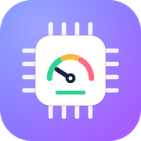</p>

# KafkaBoost — keep a gaming laptop under 100 °C

A guided, reversible [ThrottleStop](https://www.techpowerup.com/download/techpowerup-throttlestop/) tuning for the **Lenovo Legion 83DE
(Intel Core i9-14900HX)**: undervolt, boost-clock caps and power limits, a one-click installer, an always-on watchdog, and an
Electron app whose **Dashboard** screen tells you whether the optimization is still in place after a Windows update.

> The product is called **KafkaBoost**. The GitHub repository (`legion-14900hx-throttlestop`), the app id, the scheduled task names, the `%ProgramData%\LegionTuning` folder and the package name keep their historical names on purpose: renaming them would break existing installs and auto-update.

## Live pages

| Landing page (`docs/index.html`) | About the app (`docs/about-app.html`) |
|---|---|
| <a href="docs/index.html">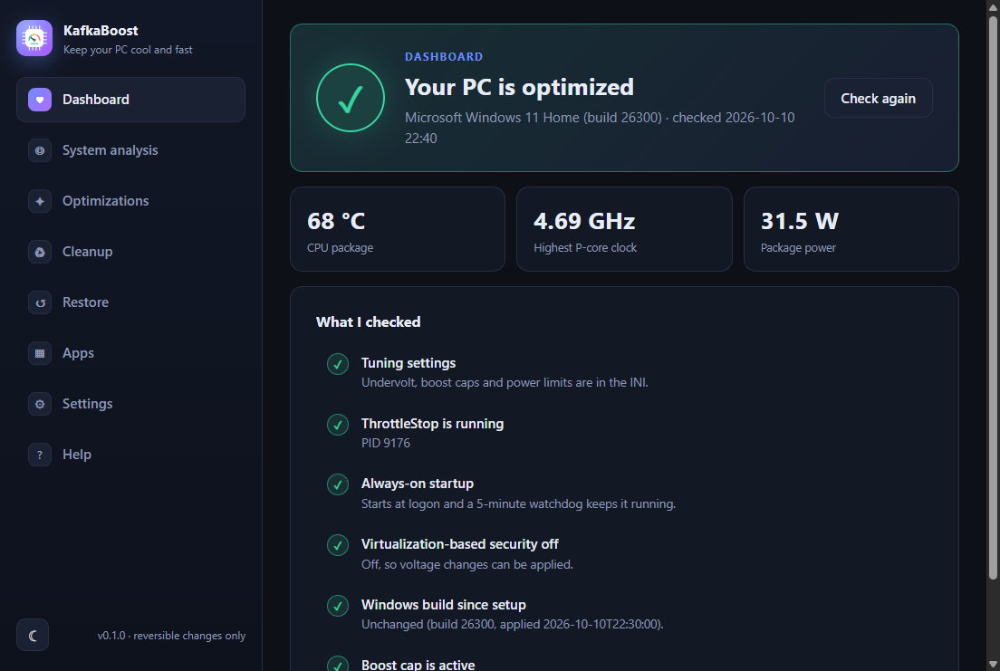</a> | <a href="docs/about-app.html">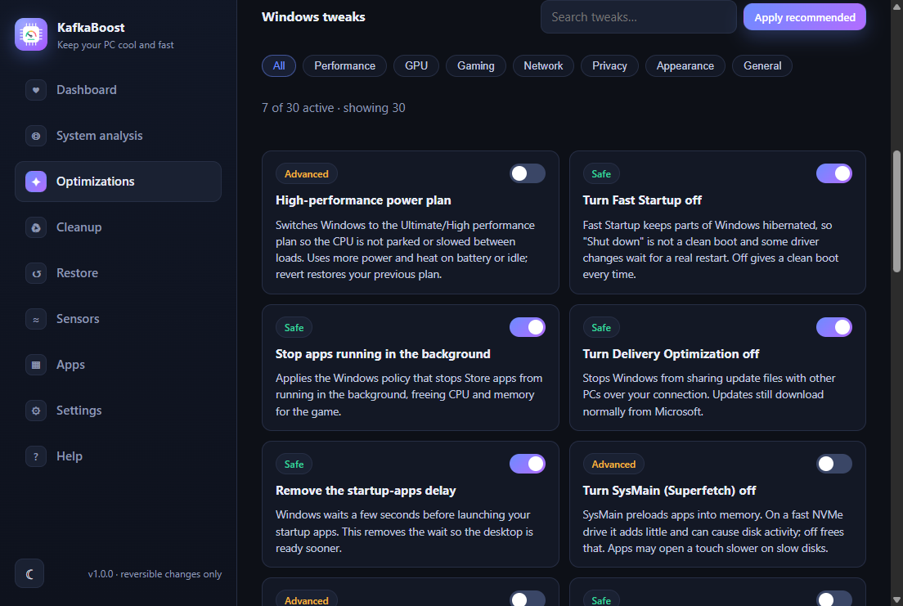</a> |
| Product page: how it works, real numbers, results with their caveats, features, availability per OS. [EN](https://carloskafka.github.io/legion-14900hx-throttlestop/) · [PT-BR](https://carloskafka.github.io/legion-14900hx-throttlestop/pt-br/) | The documentation hub: overview, quick start, walkthrough, what gets applied, troubleshooting, roadmap. English only. [Open](https://carloskafka.github.io/legion-14900hx-throttlestop/about-app.html) |

Other pages (English and `pt-br/`): `compare.html`, `download.html`, `faq.html`, `privacy.html`, `terms.html`. `node tools/check-site.js` verifies links, anchors, language parity and the numbers.

## What This Project Does

It lowers the CPU's heat (voltage, boost ratios, power limits) and makes sure the tuning is applied at every logon and stays applied.

| Result on the reference laptop (19-min CS2 sessions) | Before | After |
|---|---|---|
| Peak CPU temperature | 99–100 °C | **90 °C**, no thermal throttling |
| Average CPU temperature | 91 °C (owner's figure, see note) | about 79 °C (flat for the whole session) |
| Peak package power | 139 W | 73 W |
| Peak P-core clock | 5.39 GHz | 4.69 GHz (47x) |

Measured with HWiNFO shared memory. The "before" figures are maxima from screenshots, not a controlled A/B test: **the 91 °C before-average is the owner's own figure and is not backed by a recorded log** (the old screenshots cut the average column off), so treat the average improvement as indicative; the 10 °C lower peak and the end of thermal throttling are what was measured). To measure it, roll everything back, log a 19-minute session with `scripts\monitoring\hwinfo_logger.ps1`, then re-apply. FPS was not
measured (the game felt as smooth). See [`docs/RESULTS.md`](docs/RESULTS.md).

## The problem it solves

- **Stutter that grows with session length:** the CPU hits 100 °C, throttles, frame times spike — in CS2 and every other game.
- **The fix is scattered and easy to get wrong:** undervolt values, boost-ratio bytes, power-limit encodings and hidden checkboxes
  are copied between forum threads and are specific to a chip. One hidden checkbox ("Disable Controls") silently blocked every
  power limit we set.
- **It does not survive:** ThrottleStop is not a service. Close it, reboot without it, or take a Windows update (which can switch
  VBS back on and lock the voltage controls) and the laptop quietly returns to stock heat.
- **It is easy to go too far:** aggressive undervolts on 13th/14th-gen chips cause silent errors or degradation; without backups
  and a baseline you cannot tell.

This project gives you a **guided and reversible** setup, an **always-on** watchdog, and a **health check** with a one-click *Fix it*.

## Quick Start

### 1. Prerequisites
- Windows 11 on a Lenovo Legion 83DE with an i9-14900HX (other systems are refused), administrator rights, laptop plugged in.
- ThrottleStop (tested with **9.7.3**). The app can download it from [TechPowerUp](https://www.techpowerup.com/download/techpowerup-throttlestop/) for you, only after you tick the box in the wizard. An existing copy is found and used as is: the zip in `Downloads`, an extracted folder in `Downloads`, `Desktop` or `Documents`, or the folder your startup task already uses.
- Optional: Node.js 20+ to run the app from a clone.

### 2. Install
Double-click **`install.cmd`** (asks for administrator rights), answer **y** to the VBS question (needed for the undervolt; breaks
WSL2/Docker until restored), then **reboot**. Or open the app with **`KafkaBoost.lnk`** / **`KafkaBoost.cmd`** (repo root) and open **Optimizations**, then **CPU thermal tuning**, and follow the steps.

```
install.cmd -DisableVBS                      # no prompt
install.cmd -InstallDir "D:\ThrottleStop" -SkipVBS
```
Options: `-InstallDir`, `-ZipPath <zip>`, `-SkipVBS`, `-NoStart`, `-HWiNFODir <dir>`, `-TaskOnly`.

### 3. Check it and make a shortcut
Open the app: **Dashboard** should say *Your PC is optimized*. Create a desktop and Start Menu shortcut with the app icon (the
"run as administrator" flag is set):

```powershell
powershell -File scripts\Create-Shortcut.ps1
```
The repo root already has `KafkaBoost.cmd` (all systems with Node.js), `KafkaBoost.command` (macOS) and a generated `KafkaBoost.lnk`
(icon, runs as administrator). macOS and Linux were never run.

Run from a terminal: `cd app; npm install; npm start` (administrator needed to apply anything). Look around without changing the PC:
`cd app; $env:WIZARD_DEMO='1'; npx electron .`.

## The app (`app/`)

| Dashboard — health check | After a Windows update |
|---|---|
|  | 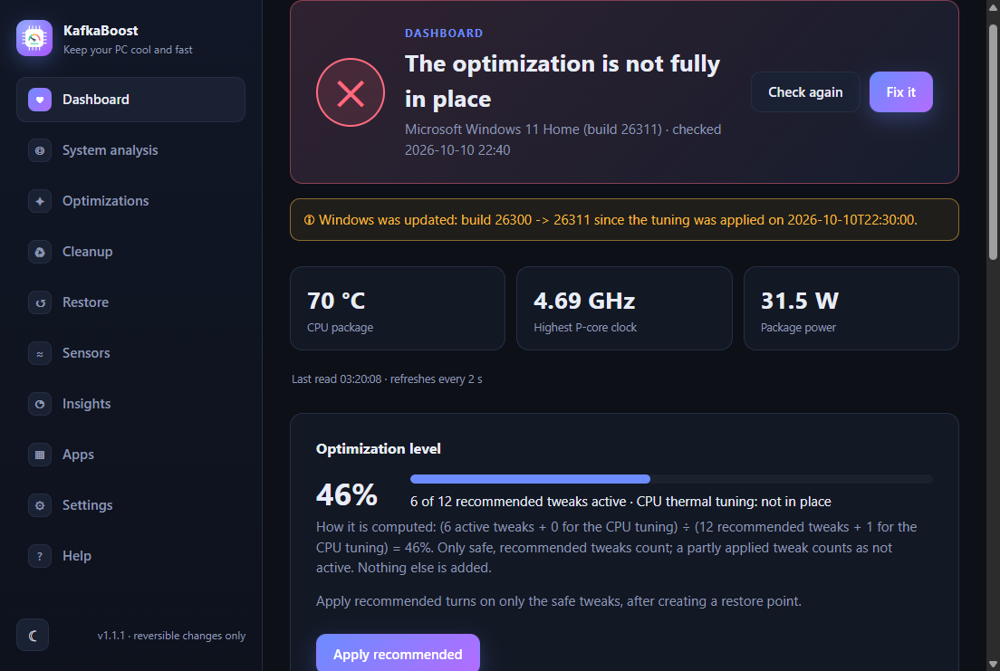 |

| Optimizations — tweak catalog | Cleanup | Settings |
|---|---|---|
|  | 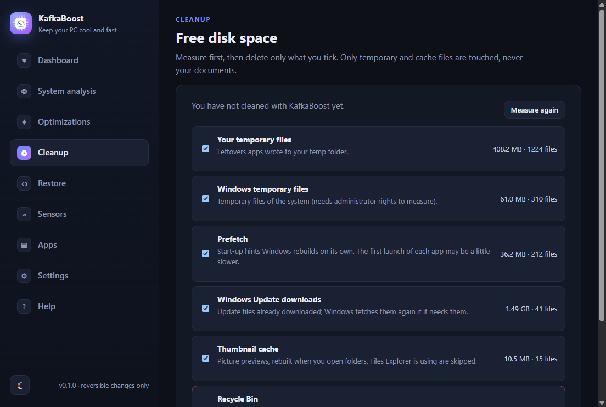 | 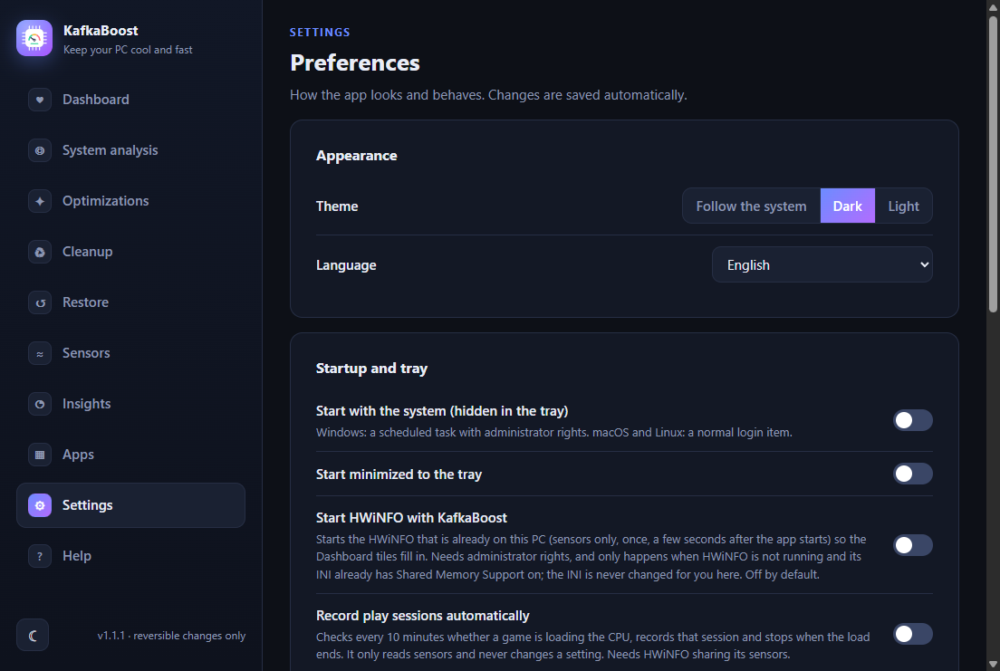 |

The side menu has ten sections: **Dashboard**, **System analysis**, **Optimizations**, **Cleanup**, **Restore**, **Sensors**, **Insights**, **Apps**, **Settings** and **Help**. **Insights** (Windows only) records play sessions (temperature, P/E clocks and package power every 5 s, manually or automatically) and gives advisory boost clock advice that never changes a setting.
The app is being renamed **KafkaBoost** (launchers and window already; the repo, package ids and task names keep their old names).
Light and dark theme, English and Brazilian Portuguese.

- **Dashboard** compares the settings, the startup task, VBS and the Windows build with the moment you set it up, offers **Fix it**, which re-applies only what drifted, and adds: **live tiles** (CPU package temperature, highest P-core clock, package
  power) read from HWiNFO shared memory about every 2 s while the Dashboard and the window are visible, each labelled with the time it was read
  and never faked; when they cannot be read the app says why (not elevated: *Run KafkaBoost as administrator*, with a restart button, because
  HWiNFO runs elevated and a normal app cannot open its sensors; elevated: the notice says in words whether HWiNFO is not installed, not running or running with Shared Memory Support off, and for an installed but stopped HWiNFO it offers a one-click *Start HWiNFO*, with an explicit checkbox when its INI has shared memory off);
  **hardware cards** (processor, graphics, memory with speed, each disk by model, size and type, system; never a serial number); an
  **optimization level** computed only from real data, `(active safe recommended tweaks + 1 if the CPU tuning is in place) / (safe recommended
  tweaks available + 1 when the CPU tuning applies)`, with the formula shown; and **Apply recommended** (same confirmation as in
  Optimizations: restore point first, safe tweaks only).
  Under the tiles, the **Live telemetry source (HWiNFO)** card gets HWiNFO for you: *Check what will be downloaded* reads the official
  [download page](https://www.hwinfo.com/download/) and shows the version, the source address and the expected signer; after you tick
  the consent box, *Download and install* fetches the portable zip, requires `HWiNFO64.exe` inside it and a **valid digital signature
  from REALiX**, and unpacks only that exe (plus `config\HWiNFO64.INI`, sensors-only with shared memory on) under
  `%ProgramData%\LegionTuning\hwinfo\<version>`. An HWiNFO you already have (Downloads, Desktop, Documents, `C:\Tools`, Program Files) is
  reused: its INI is never overwritten (turning shared memory on in it asks first and keeps a timestamped `.bak`). *Start* never passes
  arguments to HWiNFO and never starts a second copy; *Stop* only ends the process that runs from that exact file. Installing, starting
  and stopping need administrator rights. **Settings > Start HWiNFO with KafkaBoost** (off by default) starts an installed HWiNFO once, a few seconds after the app starts (also when it starts hidden at logon), only if it is not running and its INI already has shared memory on; it never edits the INI for you. HWiNFO is proprietary freeware for non-commercial use and is **not** in this repository.
  If the site answers with a protection page instead of the zip, the card says so and lets you pick a zip you downloaded yourself
  (same checks). **Not run on the PC yet:** the elevated install, start and stop, the Dashboard notice's Start button and the start-with-the-app setting (only run against the demo and fakes; see `docs/TESTING.md`).
- **System analysis** is a read-only look at the PC (model, CPU, GPU, RAM, Windows, power plan, VBS) and whether the tuning can be applied.
- **Optimizations** is a catalog of 31 tweaks (performance, GPU, gaming, network, privacy, appearance) with search, category
  filters and a risk badge on each (`safe`, `advanced`, `risky`). Toggle one on and the previous value is saved, so toggling it
  off restores exactly what was there. *Apply recommended* applies only the safe ones; advanced ones ask first; the two risky
  ones (Defender real-time protection, core isolation) need two confirmations. No FPS gain is promised: nothing here was
  benchmarked. **CPU thermal tuning** is the ThrottleStop setup: a step-by-step wizard from step 0 (hardware check) to step 6
  (verify).
- **Cleanup** measures first (temp files, Prefetch, Windows Update downloads, thumbnail cache, Recycle Bin) and deletes only what
  you tick; locked files are skipped, junctions are never followed, and the Recycle Bin (permanent) asks twice.
- **Restore** lists your Windows restore points, creates one on demand and opens Windows System Restore. KafkaBoost also creates one before your first tweak or *Apply recommended* (Windows allows one per 24 hours; if it declines, the app says so and still applies the tweak). It also undoes the CPU tuning (startup task, INI backup, optionally VBS). **Settings** has theme, language, tray options,
  start with Windows, check interval, ThrottleStop folder and the update check. **Help** has short answers and the documentation links.
- **Sensors** (Windows) shows live temperatures, clocks, voltages, power, fans and load for the CPU, GPU, board, disks and memory, refreshed about every 2 s while the screen is open, with a pause button, session min/max, generic warm (80 C) and hot (90 C) highlights and a copy/save of the snapshot as JSON. It is a viewer of the HWMonitor kind; it does **not** measure DPC/ISR latency, so it does not replace LatencyMon. The sensor library is [LibreHardwareMonitor](https://github.com/LibreHardwareMonitor/LibreHardwareMonitor) (MPL-2.0). It is not bundled: when you tick the consent box and click *Get sensor support* the app downloads the pinned release from GitHub, refuses it if its SHA-256 differs from the one in `config/sensors.json`, unpacks only the DLLs under `%ProgramData%\LegionTuning\sensors` and deletes the zip. CPU temperature, clocks and power additionally need the third-party **PawnIO** driver, which the app does not install (without it they are shown as missing, not zero); disks and board sensors need administrator rights. We did not test any anti-cheat with that driver. Verified on a real PC: the download and hash check and a non-elevated read; **an elevated read was not run**.
- **Apps** installs and removes a short list of popular apps (browsers, Steam, Discord, VLC, OBS, 7-Zip and more) with the package manager your system already has: winget on Windows, Homebrew on macOS, Flatpak (or apt, dnf, pacman through a password prompt) on Linux. It works on all three systems, bundles nothing, and removing an app asks first. You can also search the package manager, export the installed list to a JSON file and import it on another PC (the app shows the list and asks before installing anything). On Windows it can also remove pre-installed Store apps (News, Solitaire, Clipchamp and others) from a fixed list, one at a time; each can be reinstalled from the Microsoft Store. The ids were checked against the package sites, but only the read-only Windows parts (`winget list`, `winget search`, the Store-app list) were run on a real machine: **installing and removing with winget was not run for real, and the macOS and Linux code was never run at all**; it is covered by unit tests with a fake command runner.

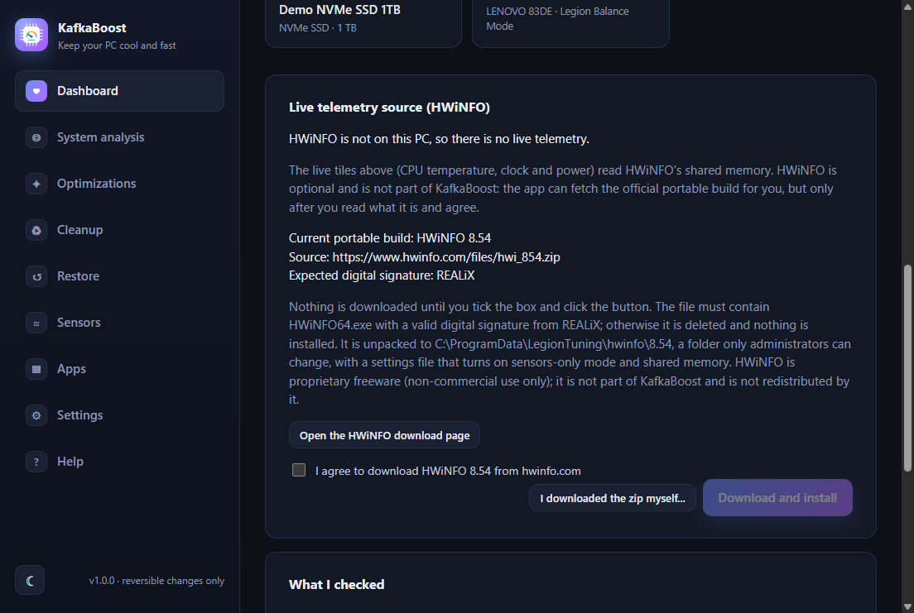

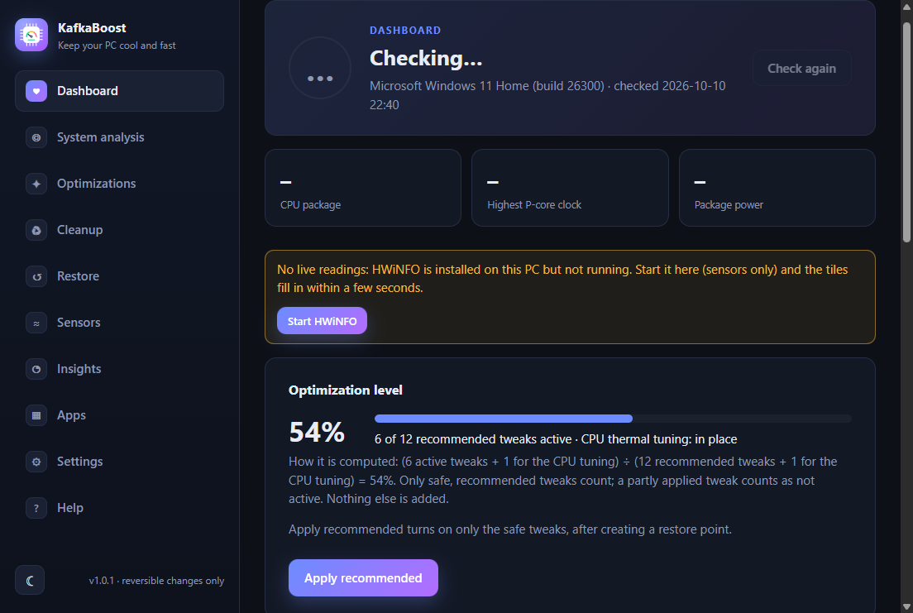

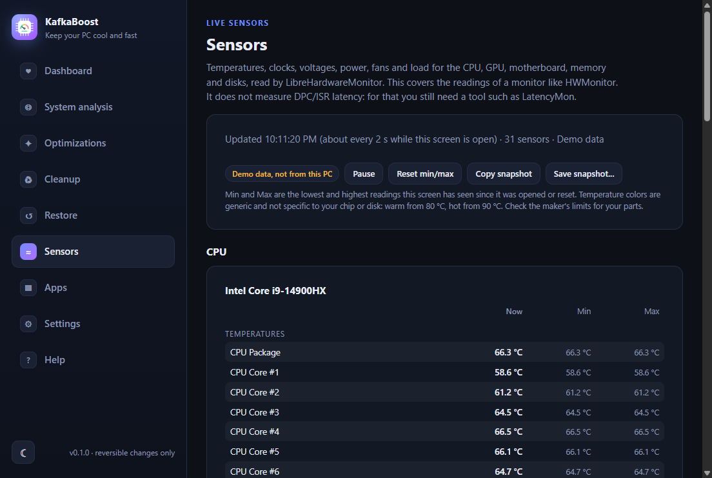

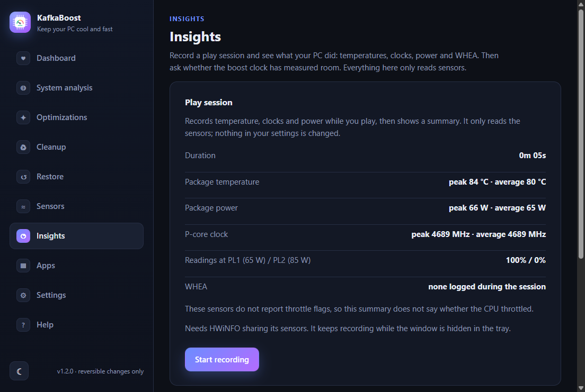

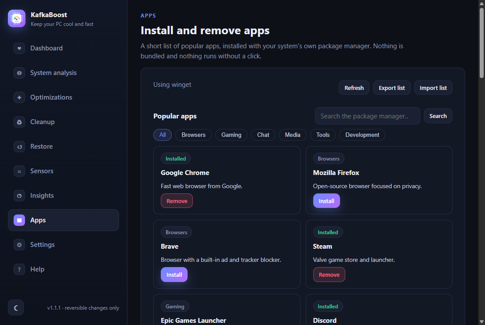

- **Updates:** the app looks at this repo's GitHub Releases and shows the changelog when a newer version exists. *Check for
  updates* in Settings shows the new version with its button on the right. The **installed** Windows build downloads the update
  and offers *Restart and update*. A **source clone or the portable exe cannot update itself**; the app says so, and when the
  release has `KafkaBoost-Setup-X.Y.Z.exe` it offers *Download and install*: the file goes to a private temp folder, its SHA-256 is
  checked against the release's `SHA256SUMS.txt` (no checksum file, or a mismatch, means it is never run), and only after you
  confirm does the installer start (Windows asks for administrator permission and, because the installer is not code-signed,
  SmartScreen may warn; neither is bypassed) and KafkaBoost closes. For a clone this makes a separate installed copy; the clone
  folder is not changed (update it with `git pull`). Leftover downloads are removed at the next start.

- **Counter-Strike 2** (Windows; *Optimizations > Counter-Strike 2*) is the one game-specific page, three optional parts, each explained and undoable. It makes **no FPS promise** and no anti-cheat claim: these are standard Windows and game settings, the only game file written is `autoexec.cfg`, nothing is patched or injected, and **we did not test how VAC or any other anti-cheat reacts**. (1) *GPU preference*: finds `cs2.exe` read-only through Steam (`HKCU\Software\Valve\Steam`, every library in `libraryfolders.vdf`; or you pick the file) and sets Windows' per-app *High performance* (`HKCU\Software\Microsoft\DirectX\UserGpuPreferences`, the same switch as Settings > Display > Graphics). The previous data is recorded and put back exactly (or the entry is removed if there was none); a preference you set yourself is never reverted by us. (2) *autoexec.cfg*: two suggested lines you tick (`cl_showfps 1`, and `fps_max` with your own number), written to `game\csgo\cfg` after copying any existing file to `autoexec.cfg.bak_<time>`; *Restore previous* puts the original back, or removes our file when there was none, and only while the file still carries our `// Written by KafkaBoost` line. We could not verify from outside the game whether CS2 runs `autoexec.cfg` by itself, so the page says to check in game (`exec autoexec`, or the `+exec autoexec` launch option). (3) *Launch options*: a string you copy into Steam, with each option explained and marked suggested, disputed or placebo; Steam's `localconfig.vdf` is never edited. **Verified on the real PC:** only the read-only detection (it found the game in a second Steam library); the GPU preference and `autoexec.cfg` writes were run only against sandbox folders and registry keys, and **not in game**.

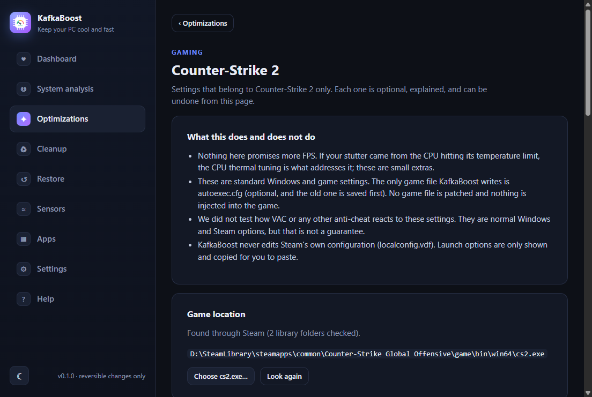

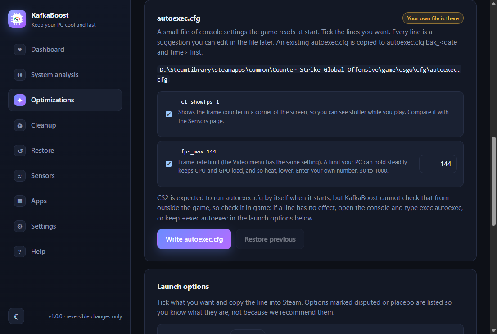

Every screen is in the [live docs](https://carloskafka.github.io/legion-14900hx-throttlestop/about-app.html#/walkthrough). Screenshots come from
demo mode (`tools\make-shots.ps1`). Linux, macOS and other CPUs get an explanation screen instead.
## Runs in the background (system tray)

Close the window and the app keeps running next to the clock. The tray icon carries the verdict as a coloured dot (green optimized,
amber needs a look, red not fully in place, grey checking). It re-checks every 30 minutes and shows a notification when something
breaks, for example after a Windows update; click the icon to open the app, right-click for *Open*, *Check now*, *Start with Windows*
and *Quit*. *Start with Windows* (also in **Help > Background**) registers a scheduled task that opens the app hidden in the tray at
logon. Only one copy runs at a time.
## What gets applied (`config/ThrottleStop.settings.ini`, profile 0)

| Setting | Value |
|---|---|
| CPU Core / P-cache undervolt | −100 mV / −100 mV |
| E-cache undervolt | −90 mV |
| V/F point 1 (800 MHz) "mV Boost" | +100 mV |
| P-core / E-core turbo cap | 47x (4.7 GHz) / 36x (3.6 GHz) |
| PL1 / PL2 | 65 W / 85 W |
| IccMax (core) | 511.75 A (max) |

**The undervolt is silicon-specific.** This chip logged a corrected WHEA "Internal parity error" at −100 mV, so do not go deeper; on
a different CPU these values are not a recipe. Encoding and every key: [`docs/CONFIGURATION.md`](docs/CONFIGURATION.md).

## Always running

The installer registers the task `ThrottleStop_Autostart`: at logon, highest privileges, no battery or time limits, **plus a
5-minute watchdog** that starts ThrottleStop only if it is not running (never a second copy).

## Monitoring

- `config\HWiNFO64.INI` turns on HWiNFO shared memory (`SensorsSM=1`). Never launch HWiNFO with command-line arguments (the free
  version shows an error). The Dashboard card does all of this for you (see above); by hand, put the INI next to `HWiNFO64.exe`.
- `scripts\monitoring\hwinfo_logger.ps1` logs temperatures, clocks, power and throttle flags every 2 s to `logs\hwinfo_log.csv`.
- `scripts\monitoring\perf_logger.ps1` logs CPU frequency / memory counters (UTF-8 BOM, pt-BR counter names).

## Restoring WSL2 / Docker

`scripts\maintenance\restore_vbs.ps1` (as administrator, then reboot) re-enables VBS and the hypervisor. The undervolt stops working
while it is on; the boost and power caps are separate and may still apply.

## Limitations

- **Not tested on a fresh Windows install.** Tested: unpacking from a zip, creating/merging the INI, registering the task, the
  watchdog (no duplicates, restarts when closed), the health check and the demo UI. Not tested: the changing wizard steps through
  the UI, the Windows installer package (`npm run dist` builds an unsigned installer locally; the release workflow has not run on GitHub yet), a real in-app update, an elevated apply/revert of the tweaks on a real PC (they are tested against a sandbox registry), macOS and Linux.
- Tweaks change Windows settings; the risky ones lower security. Use at your own risk.
- ThrottleStop is not redistributed here: the app downloads it from TechPowerUp when you agree. HWiNFO (proprietary freeware, non-commercial use only) is optional and is never bundled or redistributed: the Dashboard card downloads it from hwinfo.com only after you read the version and source and tick the consent box, and refuses it unless the exe carries a valid REALiX signature. The Sensors screen downloads LibreHardwareMonitor (MPL-2.0) from its official GitHub release only when you agree; nothing of it is in this repository.
- Model-specific: Lenovo Legion type 83DE (HWiNFO calls it "Legion Pro 7 16IRX9H"). Other models need their own limits.
- Changing CPU voltages can cause instability. Use at your own risk.

## Documentation

| Document | What |
|---|---|
| [`docs/getting-started.md`](docs/getting-started.md) | step-by-step onboarding |
| [`docs/ARCHITECTURE.md`](docs/ARCHITECTURE.md) | how the app, step runner and library fit together |
| [`docs/CONFIGURATION.md`](docs/CONFIGURATION.md) | INI keys, voltage encoding, community comparison |
| [`docs/TESTING.md`](docs/TESTING.md) | unit tests, demo mode, testing a tuning change safely |
| [`docs/TROUBLESHOOTING.md`](docs/TROUBLESHOOTING.md) | lessons learned, stop conditions, rollback |
| [`docs/RESULTS.md`](docs/RESULTS.md) | measurements and the reference machine |
| [`AGENTS.md`](AGENTS.md) | current state, rules and repo map for contributors (human or AI) |

### Repository layout

```
install.cmd            one-click installer (self-elevates)
KafkaBoost.cmd/.command/.lnk  launchers for the app
app/                   Electron app: src/ (main, preload, settings, updates, i18n, tray, demo), renderer/, build/ (icons), test/ (node tests)
config/                ThrottleStop.settings.ini, HWiNFO64.INI, defaults.json, tweaks.json (tweak catalog), sensors.json (pinned sensor library), hwinfo.json (official HWiNFO page, signer)
scripts/               Install-Tuning.ps1, Steps.ps1, Create-Shortcut.ps1, lib/ (Tuning, Health, Tweaks, Cleanup, Restore, Sensors, Hwinfo), monitoring/, maintenance/
tests/                 Pester tests for the library (176)
tools/                 make-icons.js, make-shots.ps1, run-uitest.ps1 (UI checks)
docs/                  GitHub Pages site (index.html landing, about-app.html docs hub, compare/download/faq/privacy/terms, pt-br/ mirror, site.css, site.js, assets/) and the reference documents
local/                 git-ignored: backups, evidence, experiments
```

## License

KafkaBoost is open source under the [MIT License](LICENSE), copyright (c) 2026 carloskafka. The licence covers only the code in this repository.

### Third-party software

ThrottleStop, HWiNFO (proprietary, free for non-commercial use only) and LibreHardwareMonitor (MPL-2.0) are **not** part of this repository. KafkaBoost never bundles them; the app downloads them on demand from their official sources, and each keeps its own licence and terms.
